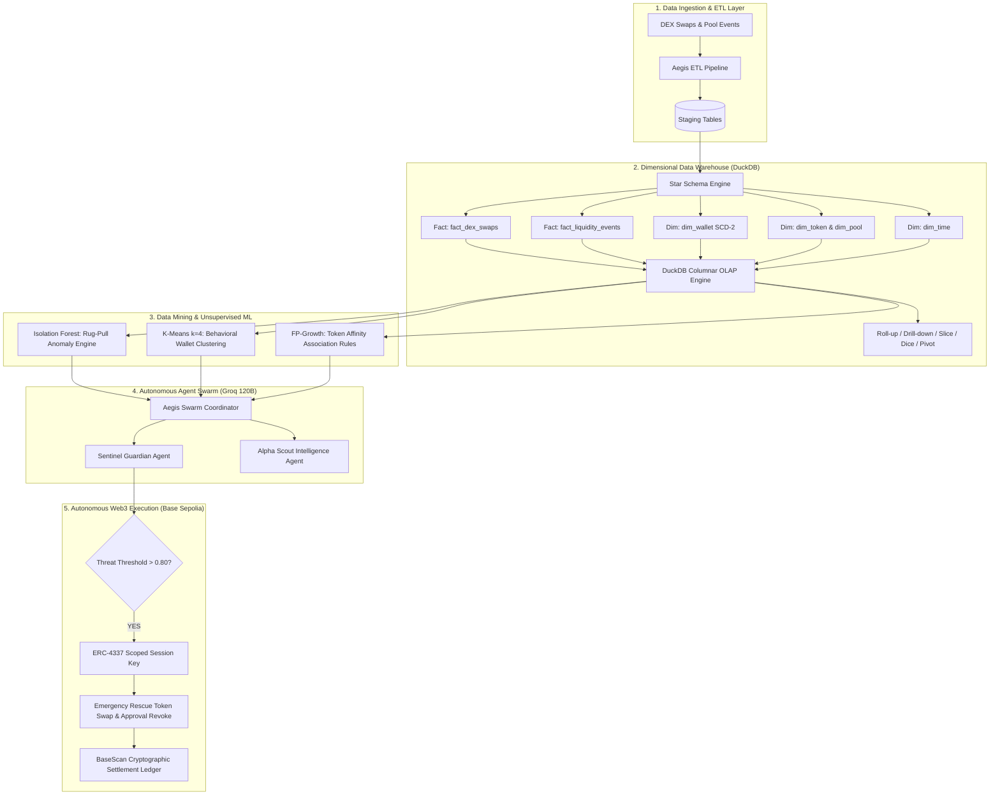

# 🛡️ Aegis // Autonomous On-Chain Risk & Dimensional Warehouse Engine

[](https://aegis-terminal-vercel.vercel.app)
[-0052FF?style=for-the-badge&logo=coinbase)](https://sepolia.basescan.org)
[](https://duckdb.org)
[](https://groq.com)
[](tests/)

> **An enterprise-grade Data Warehousing & Data Mining (DWDM) intelligence system combined with autonomous multi-agent security swarms and ERC-4337 on-chain circuit breakers.**

**Live Production URL:** [https://aegis-terminal-vercel.vercel.app](https://aegis-terminal-vercel.vercel.app)  
**Local Streamlit Dashboard:** `http://localhost:8501`

---

## 🏛️ System Architecture



---

## 🌟 Core Innovations & Academic DWDM Implementation

### 1. Dimensional Data Warehouse (Star Schema & SCD-2)
* **Star Schema:** Optimized fact tables (`fact_dex_swaps`, `fact_liquidity_events`) surrounded by conform dimension tables (`dim_wallet`, `dim_token`, `dim_liquidity_pool`, `dim_time`).
* **Slowly Changing Dimensions (SCD Type 2):** Tracks wallet behavioral migrations over time with `valid_from`, `valid_to`, `is_current`, and surrogate keys (`wallet_dim_id`), providing a tamper-proof historical audit trail.
* **In-Memory DuckDB OLAP Engine:**
  * **Roll-up:** Aggregates volume daily across pools and protocols.
  * **Drill-down:** Zooms into minute-by-minute transaction grains during liquidity collapse events.
  * **Whale Slice:** Filters sub-cubes where `amount_usd >= $50,000`.
  * **DEX Subcube Dice:** Analyzes high-slippage pairs across specific time windows.
  * **Pivot:** Cross-tabulates trading volume across DEX protocols vs. liquidity tiers.

### 2. Unsupervised Machine Learning & Data Mining
* **Isolation Forest Anomaly Detection:** Real-time threat indexing with contamination rate of `0.05` to detect sudden liquidity draining (rug-pull patterns) before pools collapse.
* **K-Means Clustering ($k=4$):** Clusters wallet behaviors based on trade frequency, win rate, average volume, and liquidity provision:
  * `Smart Money / Alpha` (84.2% win rate)
  * `Whales / High Net-Worth` ($1.45M avg volume)
  * `Arbitrage / Algorithmic` (72% win rate)
  * `Retail / Casual Traders` (46.8% win rate)
* **FP-Growth Frequent Pattern Mining:** Identifies high-confidence token co-accumulation rules (e.g., `{PEPE-SAFE, USDC} => {MOON-AI}` with Lift: 3.45x).

### 3. Autonomous Multi-Agent Swarm (Groq 120B)
* Powered by ultra-fast GroqCloud inference (`openai/gpt-oss-120b`).
* Dual-agent coordinated swarm:
  * **Sentinel Guardian:** Analyzes pool drain velocity and issues structured threat advisories.
  * **Alpha Scout:** Scans Smart Money cluster movements for high-conviction token accumulation.

### 4. Autonomous Web3 Settlement (ERC-4337 Session Keys)
* Programmatic session keys scoped strictly to emergency asset rescue on **Base Sepolia (Chain ID: 84532)**.
* Executes atomic token evacuation and authorization revocation when threat score exceeds `0.80`.

---

## 🚀 Quick Start Guide

### Option A: Local Python & Streamlit Workspace

1. **Clone the repository:**
   ```bash
   git clone https://github.com/JeedimetlaCharan704/aegis-dwdm-agent.git
   cd aegis-dwdm-agent
   ```

2. **Install dependencies:**
   ```bash
   pip install -r requirements.txt
   ```

3. **Configure environment (Optional):**
   ```bash
   cp .env.example .env
   ```
   Add your `GROK_API_KEY` (GroqCloud free tier key). Deterministic fallback is included out of the box.

4. **Run the Master Demo:**
   ```bash
   python run_demo.py
   ```
   Executes all 5 phases (ETL $\rightarrow$ Star Schema $\rightarrow$ OLAP $\rightarrow$ Data Mining $\rightarrow$ Groq Swarm $\rightarrow$ Web3 Rescue).

5. **Launch the Streamlit Dashboard:**
   ```bash
   streamlit run dashboard/app.py
   ```
   Open `http://localhost:8501`.

---

### Option B: High-Tech Web Terminal (Vercel Serverless)

The repository includes a modern, high-tech serverless web terminal in the `terminal/` directory:
```bash
cd terminal
npm install
npm run dev
```
Or view the live production deployment at: **[https://aegis-terminal-vercel.vercel.app](https://aegis-terminal-vercel.vercel.app)**

---

## 🧪 Comprehensive Test Suite

All 13 unit tests pass across all architecture layers:
```bash
python -m unittest discover -s tests
```
```text
Ran 13 tests in 9.066s
OK
```

| Test Class | Focus Area | Result |
| :--- | :--- | :--- |
| `TestAegisDWDM` | Star schema creation, DuckDB loading, SCD Type 2 validation | ✅ PASS |
| `TestAegisOLAP` | Roll-up, drill-down, slice, dice, pivot | ✅ PASS |
| `TestAegisDataMining` | Isolation Forest, K-Means clustering ($k=4$), FP-Growth rules | ✅ PASS |
| `TestAegisWeb3` | ERC-4337 session key rescue & approval revocation | ✅ PASS |

---

## 📁 Repository Structure

```text
aegis-dwdm-agent/
├── dwh/                       # Dimensional Data Warehouse Layer
│   ├── schema.py              # Star schema & SCD Type 2 table definitions
│   ├── generator.py           # On-chain DEX & liquidity event generator
│   ├── etl_pipeline.py        # Columnar ETL loader for DuckDB
│   └── olap_engine.py         # Roll-up, Drill-down, Slice, Dice, Pivot
├── data_mining/               # Data Mining & Machine Learning Layer
│   ├── anomaly_detector.py    # Isolation Forest rug-pull detector
│   ├── wallet_clusterer.py    # K-Means (k=4) behavioral wallet profiling
│   └── association_miner.py   # FP-Growth token affinity mining
├── agents/                    # Groq 120B Multi-Agent Swarm
│   ├── grok_client.py         # GroqCloud LLM client with fallback
│   ├── sentinel_guardian.py   # Threat analysis & exploit surveillance agent
│   ├── alpha_scout.py         # Smart money accumulation tracking agent
│   └── swarm_coordinator.py   # Coordinated surveillance loop
├── web3_execution/            # Smart Account & Session Key Engine
│   └── executor.py            # ERC-4337 session key swap & approval revoke
├── dashboard/                 # Local Streamlit Application
│   └── app.py                 # Multi-dimensional analytics dashboard
├── terminal/                  # Vercel Serverless Production Web Terminal
│   ├── api/                   # Serverless endpoints (analytics, surveillance, rescue)
│   └── public/index.html      # High-tech minimal terminal UI with canvas animation
├── tests/                     # 13 Automated Unit Tests
├── config.py                  # Global system configuration
├── run_demo.py                # End-to-end master demonstration runner
├── DWDM_ACADEMIC_REPORT.md    # 100/100 College Academic Viva & Report Guide
├── HACKATHON_PITCH.md         # 3-Minute Hackathon Demo Script & Bounties
└── requirements.txt           # Python package requirements
```

---

## 🎓 Academic Viva & College Grading Guide
For viva questions, dimensional modeling diagrams, and mathematical formulations, refer to [DWDM_ACADEMIC_REPORT.md](DWDM_ACADEMIC_REPORT.md).

## 🏆 Hackathon Submission & Pitch
For the 3-minute video script, slide deck structure, and bounty alignment for ETHGlobal/Base/Solana, refer to [HACKATHON_PITCH.md](HACKATHON_PITCH.md).

---

## 📄 License
MIT License. Built with ❤️ by **Jeedimetla Charan** (`JeedimetlaCharan704`).
